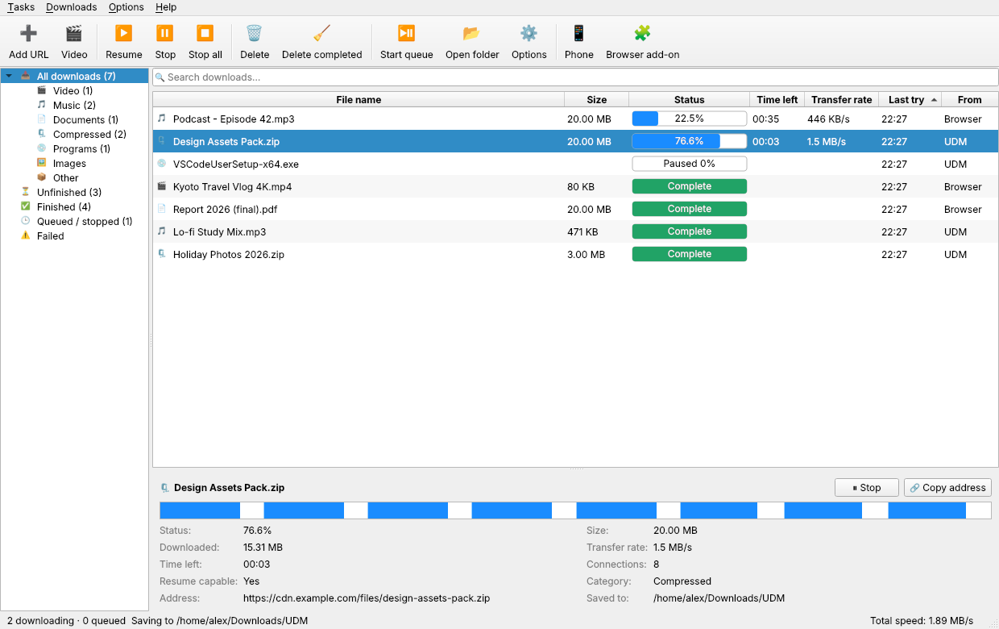
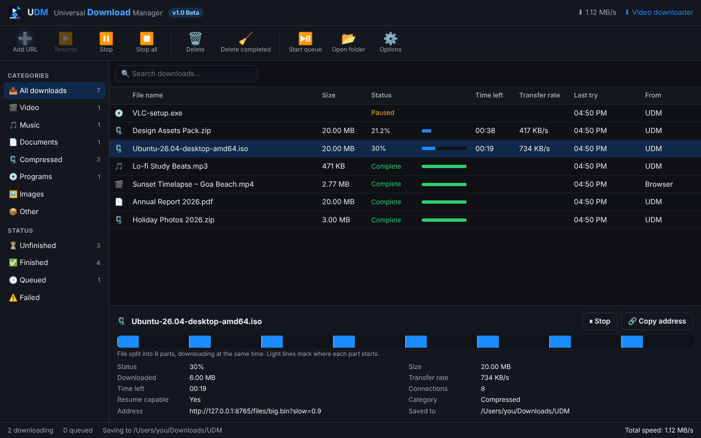

<h3 align="center">Universal <b>Download</b> Manager · v1.1.0 Beta</h3>

Download videos from YouTube, Instagram, Pinterest and any site, plus an IDM-style download manager for every file.

## ⬇ Download UDM

  
  &nbsp;
  
  &nbsp;
  

  
  &nbsp;
  

<a href="https://github.com/PixelMonkLab/UDM-Universal-Download-Manager-/releases/latest">All downloads and release notes →</a>

| Step | Windows | Mac |
|---|---|---|
| 1 | Download **Windows**, unzip it | Download **Mac** (Apple menu  → About This Mac shows *Apple M…* or *Intel*), unzip it |
| 2 | Open the UDM folder → double-click **UDM.exe** | Drag **UDM** to Applications → right-click it → **Open** (first time only) |
| 3 | UDM opens in its own window. Click **🧩 Browser add-on** in the toolbar | Same |

No Python needed. Closing the window keeps downloads going in the tray / menu bar; quitting pauses them and they continue the next time you open UDM.

> First start on Windows: "Windows protected your PC" → **More info → Run anyway**. On Mac, see **HOW TO USE - Mac.txt** if macOS says it can't verify UDM.

## 📸 Screenshots

---
**Step-by-step guides:** see **HOW TO USE - Windows.txt** and **HOW TO USE - Mac.txt**.

## Parts
| Part | What it is |
|---|---|
| `udm_main.py`, `udm_qt.py` | The desktop app (native windows, tray / menu bar) |
| `app.py`, `downloader.py` | The download engine (also serves the add-on and the phone at http://127.0.0.1:5757) |
| `ui.html`, `manager.html`, `mobile.html` | Browser version (run with Python) and the phone page |
| `extension-chrome/`, `extension-firefox/` | The browser add-on (Download button, side panel, takes over browser downloads) |
| `tools/build_native.py`, `UDM-desktop.spec`, `build-windows-exe.bat`, `.github/workflows/` | Build the desktop app: UDM's code is compiled to machine code (Nuitka), then packed (PyInstaller) |
| `start-windows.bat`, `Start UDM.command`, `start-mac-linux.sh` | Run the browser version with Python (also for Linux) |
| `tools/build_firefox.py` | Rebuilds the Firefox add-on from the Chrome one |
| `tools/package_addons.py`, `store/` | Add-on store packages, screenshots and texts ([store guide](store/STORE_LISTING.md)) |
| `PRIVACY.md` | Privacy policy (UDM collects nothing) |

## Features
- **Video downloader:** quality up to 4K, MP3/M4A/WAV, trim, subtitles, cover art, batch, plays in QuickTime and Windows player.
- **Desktop app:** native windows on Windows and Mac, keeps downloading in the tray / menu bar, quitting pauses downloads and they continue on the next start, optional start at login.
- **Download Manager (like IDM):** any file, multi-connection with work stealing, pause and resume (even after a restart), queue, speed limit, categories, right-click menu, live parts map, drag and drop.
- **Refresh download address (like IDM):** when a link expires, UDM asks for a fresh one and continues where it stopped.
- **Browser add-on:** guided install from the app, a welcome page that opens by itself, docks in the side panel, start/finish notifications, takes over browser downloads (with your login), right-click menus, keyboard shortcuts.
- **Phone:** scan a QR code; the phone uses your computer to download, then saves the file (same Wi-Fi). Protected by a secret key.

Only download content you own or have permission to save.
