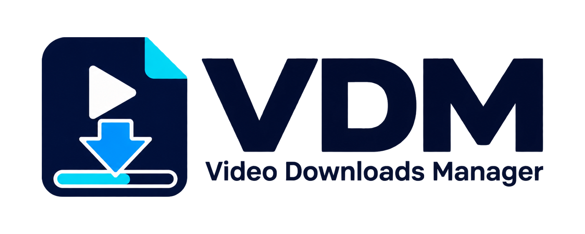
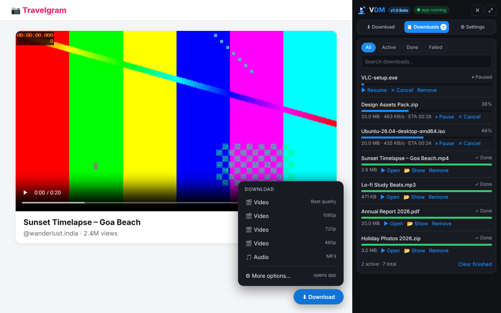

<h3 align="center">Video <b>Downloads</b> Manager · v1.0 Beta</h3>

Download videos from YouTube, Instagram, Pinterest and any site, plus an IDM-style download manager for every file.

## ⬇ Download VDM

  
  &nbsp;
  

  
  &nbsp;
  

<a href="https://github.com/PixelMonkLab/VDM-Video-Downloads-Manager-/releases/latest">All downloads and release notes →</a>

| Step | Windows | Mac |
|---|---|---|
| 1 | Download **Windows**, unzip it | Install [Python](https://www.python.org/downloads/macos/), download **Mac / Linux**, unzip it |
| 2 | Open the VDM folder → double-click **VDM.exe** | Follow **HOW TO USE - Mac.txt** (one Terminal line, once), then double-click **Start VDM.command** |
| 3 | VDM opens in your browser. Click **🧩 Install browser add-on** | Same |

> First start on Windows: "Windows protected your PC" → **More info → Run anyway**. On Mac, "Apple could not verify" → click **Done**, then see the guide.

## 📸 Screenshots

---
**Step-by-step guides:** see **HOW TO USE - Windows.txt** and **HOW TO USE - Mac.txt**.

## Parts
| Part | What it is |
|---|---|
| `app.py`, `ui.html`, `manager.html`, `mobile.html`, `downloader.py` | The VDM app (runs on your computer, opens in the browser at http://127.0.0.1:5757) |
| `extension-chrome/`, `extension-firefox/` | The browser add-on (Download button, side panel, takes over browser downloads) |
| `start-windows.bat`, `Start VDM.command`, `start-mac-linux.sh` | Start VDM with Python |
| `build-windows-exe.bat`, `VDM.spec`, `.github/workflows/` | Make **VDM.exe** (no Python needed to use it) |
| `tools/build_firefox.py` | Rebuilds the Firefox add-on from the Chrome one |
| `tools/package_addons.py`, `store/` | Add-on store packages, screenshots and texts ([store guide](store/STORE_LISTING.md)) |
| `PRIVACY.md` | Privacy policy (VDM collects nothing) |

## Features
- **Video downloader:** quality up to 4K, MP3/M4A/WAV, trim, subtitles, cover art, batch, plays in QuickTime and Windows player.
- **Download Manager (like IDM):** any file, multi-connection with work stealing, pause and resume (even after a restart), queue, speed limit, categories, right-click menu, live parts map, drag and drop.
- **Browser add-on:** guided install from the app, a welcome page that opens by itself, docks in the side panel, start/finish notifications, takes over browser downloads (with your login), right-click menus, keyboard shortcuts.
- **Phone:** scan a QR code; the phone uses your computer to download, then saves the file (same Wi-Fi). Protected by a secret key.

Only download content you own or have permission to save.
